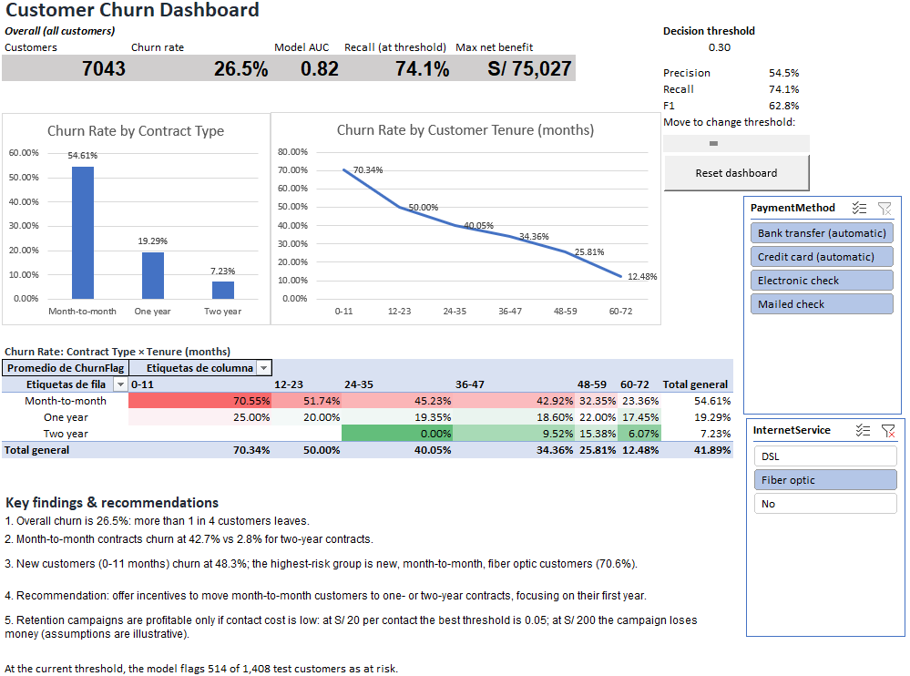
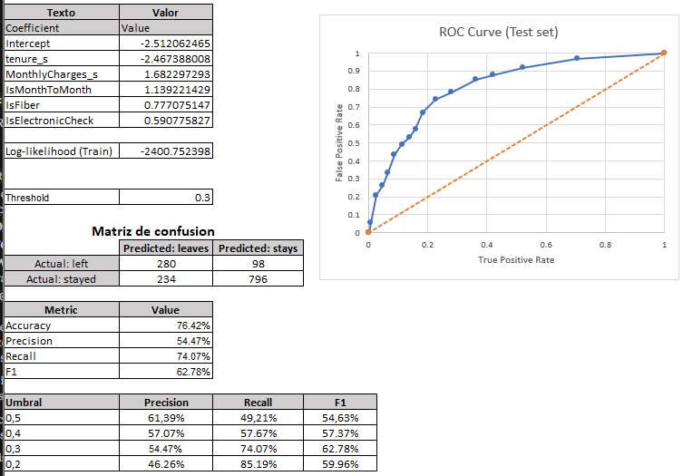
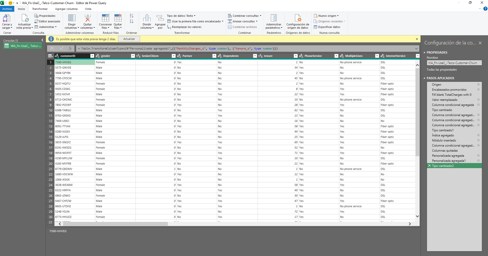
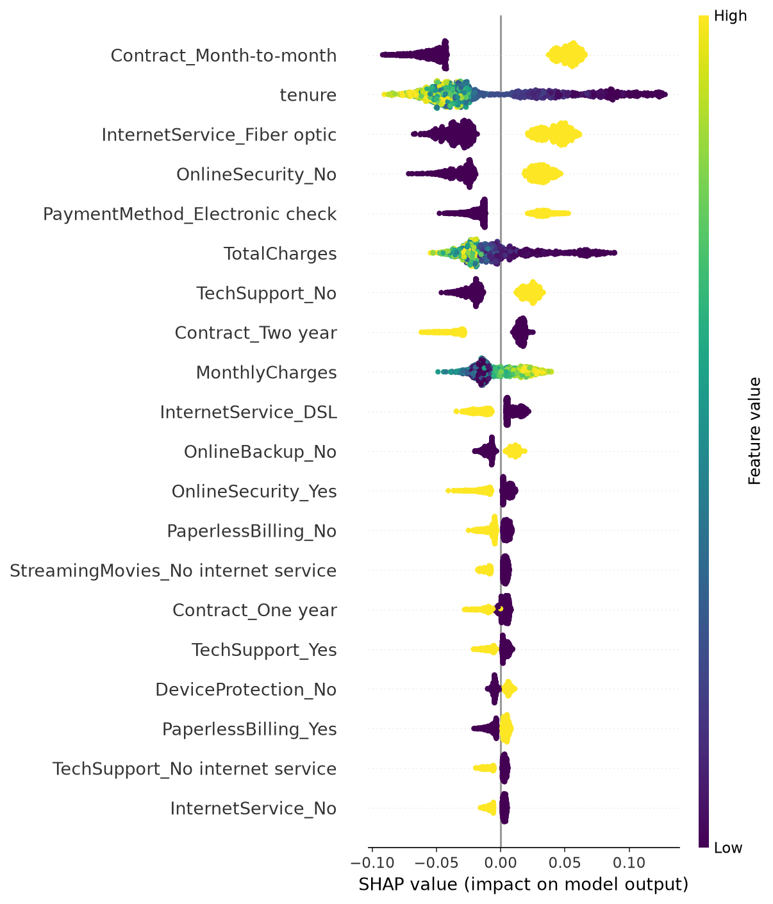
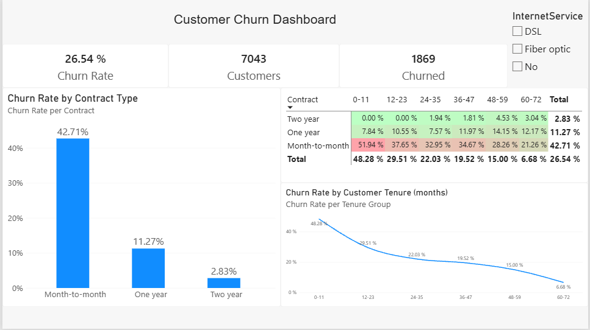

# Telco Customer Churn: End-to-End Analysis

[](https://github.com/LuisLazaroMachado/telco-churn-end-to-end/actions/workflows/tests.yml)

**Try it live:** [churn risk simulator](https://telco-churn-end-to-end-luis-lazaro.streamlit.app/).
Build a customer, read their churn risk like a phone bill and generate a
retention message with an LLM.

Predicting which telecom customers will leave, and what to do about it.
Built on the IBM Telco Customer Churn dataset (7,043 customers, 21 columns).

The same churn analysis is built in four tools (Excel, Python, SQL and
Power BI) and all of them return the same figures.

A final phase uses an LLM to turn the model's predictions into personalised
retention messages.

## Key findings

| Finding | Value |
|---|---|
| Overall churn rate | 26.5% (1,869 of 7,043) |
| Month-to-month vs two-year contracts | 42.7% vs 2.8% |
| Customers in their first year (0-11 months) | 48.3% |
| Highest-risk group: new, month-to-month, fiber optic | 70.6% |

**Recommendation:** offer incentives to move month-to-month customers to
longer contracts, focusing on their first year.

## Phase 1: Excel

Power Query cleaning, pivot tables, logistic regression trained with Solver,
evaluation, business-impact analysis, interactive dashboard and a VBA reset
button.

### Dashboard


Interactive: slicers filter the charts and heat map, and a scroll bar moves
the decision threshold and updates precision, recall and F1.



### Model

Logistic regression with 5 predictors, fitted in Excel with Solver
(maximum likelihood). Evaluated on a held-out test set (20%, 1,408 customers).

| Metric (threshold 0.30) | Value |
|---|---|
| Precision | 54.5% |
| Recall | 74.1% |
| F1 | 62.8% |
| AUC | 0.815 |




### How it was built

1. **Cleaning (Power Query):** typed columns, fixed 11 blank `TotalCharges`,
   created the target flag and model variables.

   

2. **Exploration:** pivot tables and charts by contract, tenure and
   contract x tenure.
3. **Model (Solver):** maximize log-likelihood on the training set.

   

4. **Evaluation:** confusion matrix, precision/recall/F1, ROC and AUC.
5. **Business impact:** net benefit by threshold under editable assumptions.
6. **Automation:** VBA macro that resets slicers and threshold.

## Phase 2: Python

The same analysis repeated in Python (pandas, scikit-learn, SHAP) with the same
train/test split and features, to validate the Excel model and compare it with
tree ensembles.

| Model | AUC (test) |
|---|---|
| Logistic regression, Excel (Solver) | 0.815 |
| Logistic regression, Python | 0.818 |
| Random Forest, 5 variables | 0.830 |
| Random Forest, 45 columns | 0.838 |

Python and Excel agree. Tree ensembles gain about 0.02 AUC over the simple
regression, measured on a single train/test split.

SHAP shows what drives the Random Forest predictions. Color shows the feature
value, not risk. Contract type, tenure, fiber optic, no online security and
electronic check payment are associated with higher churn (not proven causes).



Notebook: [python/01_churn_analysis.ipynb](python/01_churn_analysis.ipynb)

To run the tests: `pip install -r requirements.txt`, then
`python -m pytest python/tests`.

## Phase 3: SQL (PostgreSQL)

The flat CSV is split into a relational schema of five tables with primary
and foreign keys, `CHECK` constraints and indexes
([sql/schema.sql](sql/schema.sql)).

| Table | Contents | Keys |
|---|---|---|
| `customers` | Demographics | PK `customer_id` |
| `accounts` | Tenure, charges and churn | PK/FK `customer_id`, FK `contract_id`, FK `payment_method_id` |
| `services` | Phone, internet and add-ons (`NULL` = not applicable) | PK/FK `customer_id` |
| `contracts` | The 3 contract types | PK `contract_id` |
| `payment_methods` | The 4 payment methods, automatic or not | PK `payment_method_id` |

| Query | Technique | Result |
|---|---|---|
| Churn by contract | `JOIN`, `FILTER`, window `SUM() OVER ()` | 42.71% / 11.27% / 2.83% |
| Churn by tenure | CTE, running total | 48.28% (0-11 months) to 6.68% (60-72); 53.45% of all churn happens in the first year |
| Highest-risk group | Three-table `JOIN` | 70.55% (618 of 876) |
| Contract x tenure matrix | Pivot with `FILTER` | 51.94% for new month-to-month customers, the same as Power BI |
| Revenue lost | CTE, window function | Month-to-month contracts account for 86.86% of the monthly charges lost to churn |
| Riskiest segments | `RANK() OVER (PARTITION BY ...)`, `HAVING` | Fiber optic + electronic check ranks first in every contract type (60.37% of 1,307 month-to-month customers) |
| Protection add-ons | Boolean arithmetic, CTE | Churn falls from 56.67% with no add-ons to 5.32% with all four (an association, not a proven cause) |

All figures match the Excel and Python results. The SQL tests run against a
temporary PostgreSQL 17 server in GitHub Actions: query results are checked
against pandas on made-up data, and against the official figures locally.

To run it, add the PostgreSQL settings to `.env` (`PGHOST`, `PGPORT`,
`PGDATABASE`, `PGUSER`, `PGPASSWORD`), then:

```
python python/load_to_postgres.py
python python/run_query.py "sql/0*.sql"
```

## Phase 4: Power BI

The same dashboard rebuilt in Power BI with DAX measures: KPI cards, churn
rate by contract and by tenure group, a contract x tenure heat map and an
`InternetService` slicer.



Filtering by fiber optic raises the highest-risk cell (month-to-month,
0-11 months) from 51.94% to 70.55%, matching the Excel, Python and SQL results.


Report file: [powerbi/telco_churn.pbix](powerbi/telco_churn.pbix) (requires
Power BI Desktop, Windows). The data is embedded, so it opens without the CSV;
Refresh will fail unless you point the source to your own copy.
DAX measures: [powerbi/measures.dax](powerbi/measures.dax).

## Phase 5: LLM retention messages

The Phase 2 logistic regression scores the test customers who have not
churned yet. The customers with the highest churn probability get a short
retention message written by an LLM, in English or Spanish.

The top 3 customers are all new (3 months), month-to-month, fiber optic
customers paying by electronic check, with churn probabilities of 0.77 to
0.80: the same highest-risk group found in Phases 1 to 4.

Example output for the top customer (real run, English):

> Hi there! We hope you are enjoying your fiber optic internet experience. As
> a valued customer, we would love to help you save on your service. You are
> eligible to receive a discount simply by switching your plan to a one-year
> or two-year contract. It is a fantastic way to enjoy peace of mind and
> uninterrupted connectivity. Reach out to our friendly support team today to
> update your account and take advantage of this offer!

Design choices:

- **Privacy:** only seven profile fields are sent (tenure, contract, internet
  service, online security, tech support, payment method and monthly
  charges). No customer ID.
- **No invented promises:** the LLM picks one offer from a fixed list and is
  told not to mention prices, percentages or the churn prediction.
- **Cost control:** at most 5 customers per run, and a `--dry-run` mode that
  prints the prompts without calling the API.
- **Any provider:** works with any OpenAI-compatible endpoint; currently
  configured for Google Gemini.
- **Tested offline:** the tests replace the LLM with a fake client and never
  call the API.

To run it, create a `.env` file in the project root (it is ignored by git):

```
LLM_API_KEY=your-api-key
LLM_BASE_URL=https://generativelanguage.googleapis.com/v1beta/openai/
LLM_MODEL=your-model-name
```

Then:

```
python python/retention_message.py --dry-run
python python/retention_message.py --n 3 --lang es
```

Script: [python/retention_message.py](python/retention_message.py)

## Web app

Live: [telco-churn-end-to-end-luis-lazaro.streamlit.app](https://telco-churn-end-to-end-luis-lazaro.streamlit.app/)

A Streamlit app built on the Phase 2 logistic regression, with three tabs:

- **Risk simulator:** pick a customer profile and see each input's effect on
  the risk score, laid out like a phone bill, plus the final probability.
  The default customer scores 80%, the same as the Phase 5 script.
- **What drives churn:** the key figures and charts from Phases 1 to 4.
- **About the model:** AUC comparison and limitations.

The app stores only the model coefficients and summary figures
(`app/app_data.json`, created by `python/export_app_data.py`); no customer
rows are published. Live LLM messages are limited to 3 per visit, with a
saved real example as fallback.

To run it locally: `streamlit run app/streamlit_app.py`

## Repository structure

```
excel/    telco_churn_project.xlsx and .xlsm (with macro)
python/   notebook, churn_utils.py, retention_message.py, export_app_data.py, load_to_postgres.py, run_query.py and tests
sql/      schema.sql and 8 analysis queries (PostgreSQL)
powerbi/  Power BI report (.pbix) and DAX measures
app/      Streamlit web app and its summary data
data/     dataset description (CSV not included, see data/README.md)
docs/     screenshots and decisions.md (assumptions and limitations)
.github/  GitHub Actions workflow that runs the tests
```

## Requirements

- **Excel:** Excel 2019 or later (tested in Excel 2021) with Power Query and
  Solver. In the .xlsm version, enable macros when opening.
- **Python:** Python 3 and the packages in `requirements.txt`.
- **SQL:** PostgreSQL (tested with version 17).
- **Power BI:** Power BI Desktop (Windows).
- **LLM (Phase 5, optional):** an API key for an OpenAI-compatible provider.

## Limitations

See [docs/decisions.md](docs/decisions.md). Business figures use invented
assumptions and are illustrative.

## Roadmap

- [x] Excel: cleaning, analysis, model, dashboard, VBA
- [x] SQL: relational PostgreSQL schema and advanced queries
- [x] Python: pandas, scikit-learn, pytest
- [x] Trees and ensembles with SHAP
- [x] Power BI dashboard
- [x] LLM-generated retention messages via API
- [x] Web app with risk simulator (Streamlit)

## License

MIT