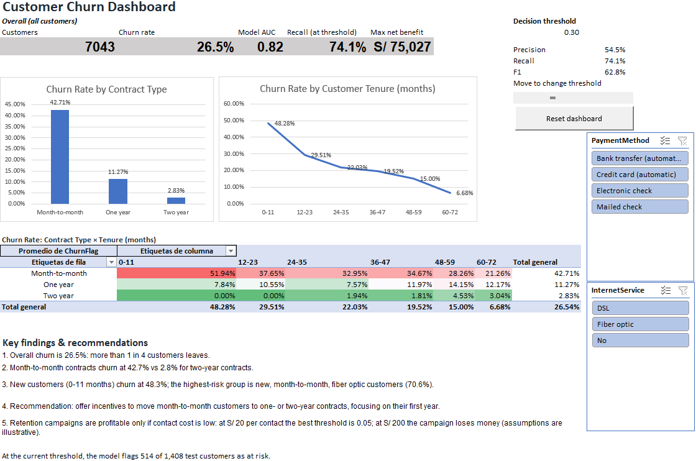
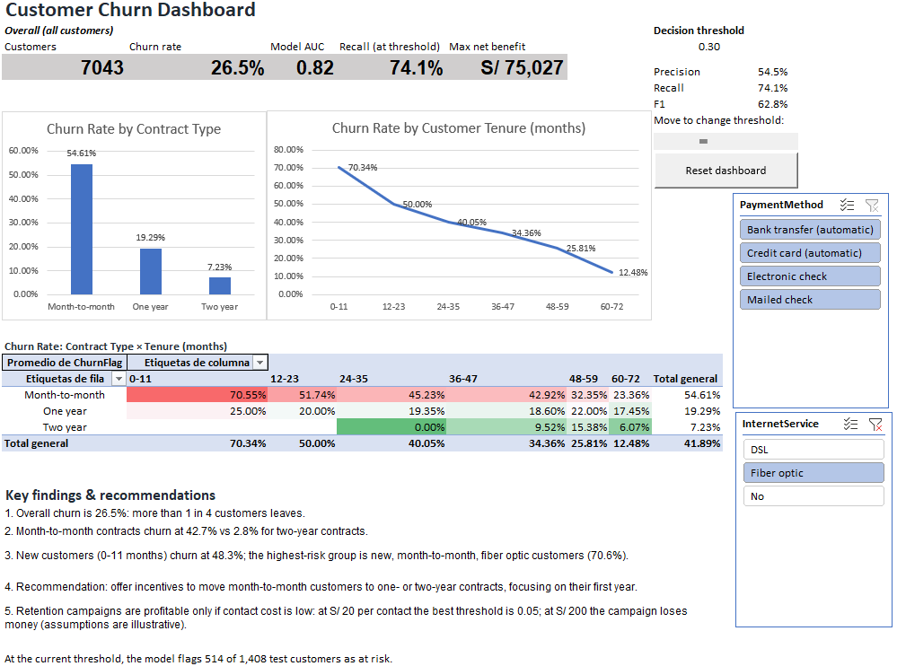
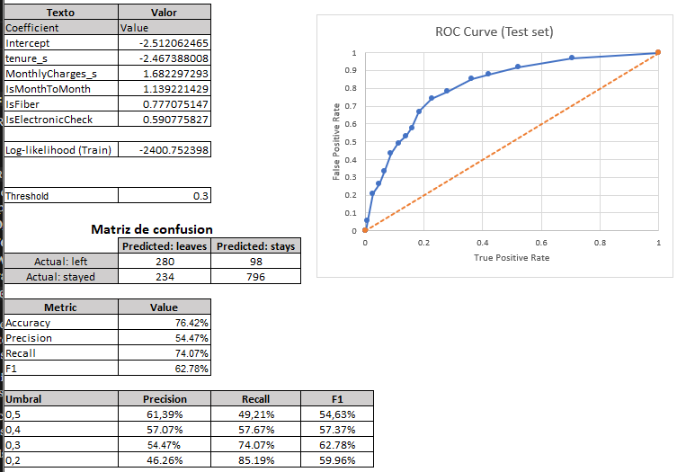
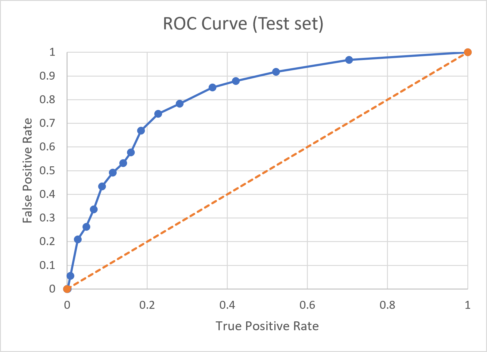
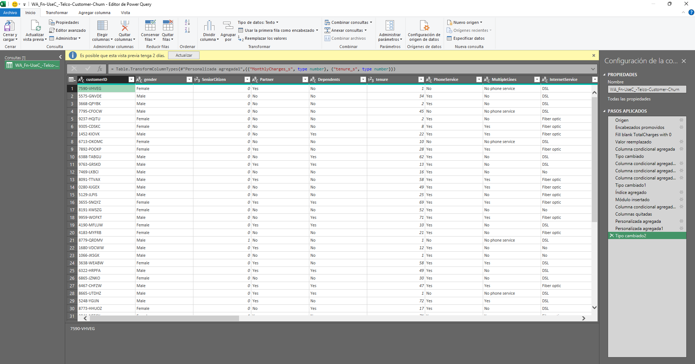
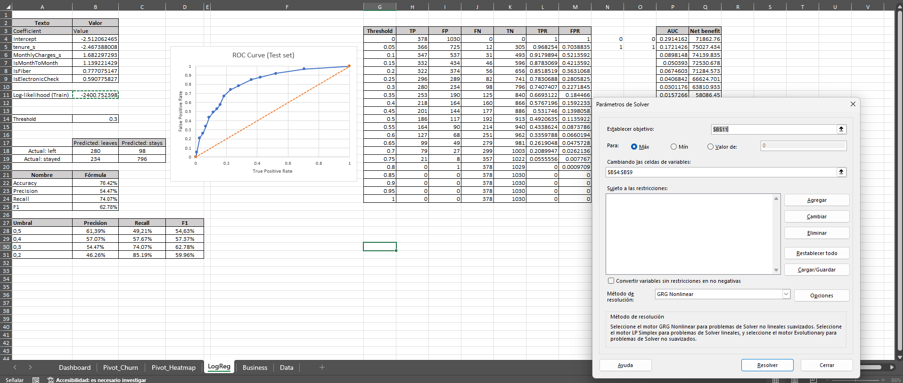
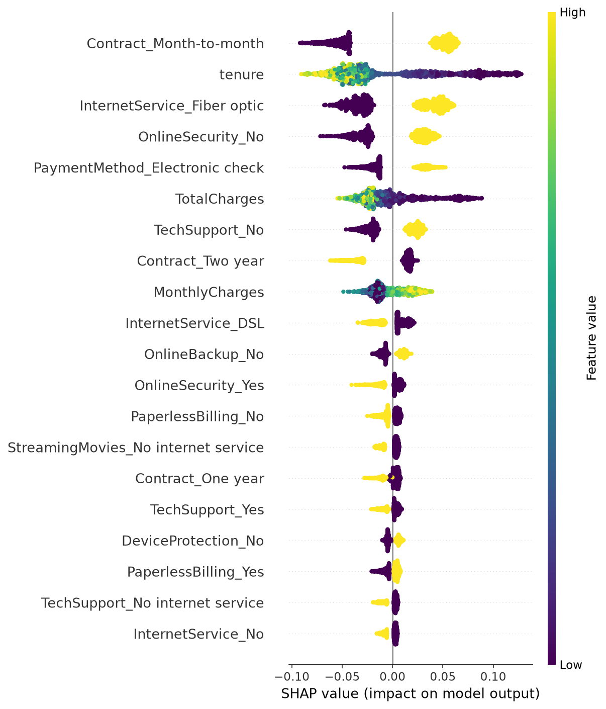

# Telco Customer Churn: End-to-End Analysis

Predicting which telecom customers will leave, and what to do about it.
Built on the IBM Telco Customer Churn dataset (7,043 customers, 21 columns).

**Phase 1 (done): Excel.** Power Query cleaning, pivot tables, logistic
regression trained with Solver, evaluation, business-impact analysis,
interactive dashboard and a VBA reset button.

## Dashboard



Interactive: slicers filter the charts and heat map, and a scroll bar moves
the decision threshold and updates precision, recall and F1.



## Key findings

| Finding | Value |
|---|---|
| Overall churn rate | 26.5% (1,869 of 7,043) |
| Month-to-month vs two-year contracts | 42.7% vs 2.8% |
| Customers in their first year (0-11 months) | 48.3% |
| Highest-risk group: new, month-to-month, fiber optic | 70.6% |

**Recommendation:** offer incentives to move month-to-month customers to
longer contracts, focusing on their first year.

## Model

Logistic regression with 5 predictors, fitted in Excel with Solver
(maximum likelihood). Evaluated on a held-out test set (20%, 1,408 customers).

| Metric (threshold 0.30) | Value |
|---|---|
| Precision | 54.5% |
| Recall | 74.1% |
| F1 | 62.8% |
| AUC | about 0.82 |




## How it was built

1. **Cleaning (Power Query):** typed columns, fixed 11 blank `TotalCharges`,
   created the target flag and model variables.

   

2. **Exploration:** pivot tables and charts by contract, tenure and
   contract x tenure.
3. **Model (Solver):** maximize log-likelihood on the training set.

   

4. **Evaluation:** confusion matrix, precision/recall/F1, ROC and AUC.
5. **Business impact:** net benefit by threshold under editable assumptions.
6. **Automation:** VBA macro that resets slicers and threshold.

## Repository structure

```
excel/    telco_churn_project.xlsx and .xlsm (with macro)
python/   notebook, churn_utils.py and tests
data/     dataset description (CSV not included, see data/README.md)
docs/     screenshots and decisions.md (assumptions and limitations)
```

To run it: `pip install -r requirements.txt`, then `python -m pytest python/tests`.

## Requirements

Excel 2019 or later (tested in Excel 2021). Power Query, Solver and the
VBA macro are required. In the .xlsm version, enable macros when opening.

## Limitations

See [docs/decisions.md](docs/decisions.md). Business figures use invented
assumptions and are illustrative.

## Roadmap

- [x] Excel: cleaning, analysis, model, dashboard, VBA
- [ ] SQL: same questions answered with queries
- [x] Python: pandas, scikit-learn, pytest
- [x] Trees and ensembles with SHAP
- [ ] Power BI dashboard
- [ ] LLM-generated retention messages via API

## License

MIT

## Phase 2: Python

The same analysis repeated in Python (pandas, scikit-learn, SHAP) with the same
train/test split and features, to validate the Excel model and compare it with
tree ensembles.

| Model | AUC (test) |
|---|---|
| Logistic regression, Excel (Solver) | 0.815 |
| Logistic regression, Python | 0.818 |
| Random Forest, 5 variables | 0.830 |
| Random Forest, 45 columns | 0.838 |

Python and Excel agree. Tree ensembles gain about 0.02 AUC over the simple
regression, measured on a single train/test split.

SHAP shows what drives the Random Forest predictions. Color shows the feature
value, not risk. Contract type, tenure, fiber optic, no online security and
electronic check payment are associated with higher churn (not proven causes).



Notebook: [python/01_churn_analysis.ipynb](python/01_churn_analysis.ipynb)